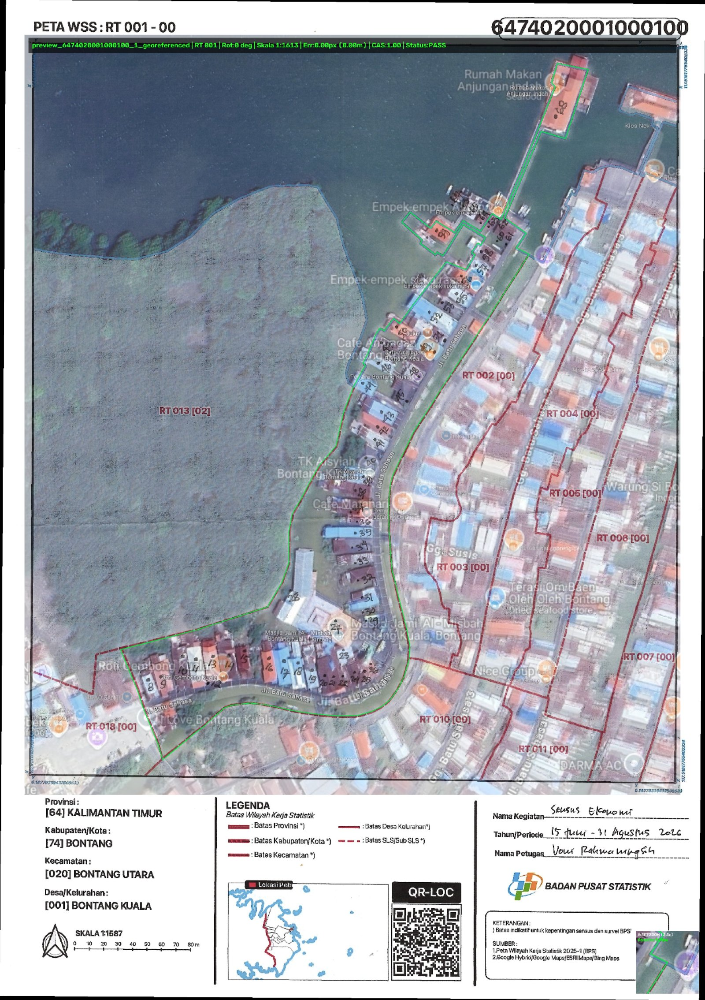

# Wilkerstat Autonomous Georeferencing Tool (v1.0.0)

[](#)
[](#)
[-orange.svg)](#)
[](#)

Aplikasi Python modular untuk menghasilkan worldfile (`.jgw` / `.pgw` / `.tfw`) presisi tinggi secara otonom dari peta scan Wilkerstat BPS. Dilengkapi deteksi arah utara otomatis (*North-Up correction*), penyelarasan kontur batas SLS (*Closed-Loop Convolutional Optimizer*), integrasi basemap satelit Google Hybrid, serta evaluasi mandiri (*Quality Gate Diagnostics & Self-Checking Verification Preview*).

> 📖 **Dokumentasi Teori & Matematika**: Penjelasan komprehensif mengenai formulasi transformasi affine, distance transform 2D, formula Slippy Map geodetik, hingga segmentasi warna diferensial dapat dibaca pada [**docs/TEORI.md**](docs/TEORI.md).

---

## 📸 Contoh Hasil & Antarmuka

### 1. Citra Verifikasi Visual Mandiri (`preview_*.png`)
Setiap peta scan yang diproses akan menghasilkan citra preview diagnostik komprehensif beresolusi tinggi:
- **Base Map**: Peta scan yang telah ditegakkan (*North-Up*).
- **Google Hybrid Basemap**: Penyelarasan citra satelit resolusi tinggi (Zoom 18) dengan transparansi 35%.
- **Target Boundary**: Garis kontur poligon GeoJSON target (hijau tebal).
- **Neighboring Boundary**: Poligon SLS tetangga (cyan).
- **Inset Zoom 2.5x**: Jendela pembesaran detail tepi batas untuk memvalidasi ketepatan piksel secara langsung.
- **Diagnostic Badge**: Status kepatuhan Quality Gate (*PASS / REVIEW / FAIL*), nilai Chamfer Error, estimasi deviasi fisik dalam meter, dan skor CAS (*Composite Alignment Score*).

<p align="center">
  
</p>

---

### 2. Live Dynamic CLI Terminal Dashboard
Proses eksekusi batch menampilkan dashboard terminal interaktif bertenaga `rich` yang memperbarui progres per peta dan tabel rekapitulasi secara *real-time*:

```text
  Memproses Dataset Peta... ━━━━━━━━━━━━━━━━━━━━━━━━━━━━━━ 100% 0:00:10
┌───────────────────────────── Status Peta Aktif ─────────────────────────────┐
│ Peta Aktif: [1/1] 6474020001000100_1_georeferenced.png (RT 01)              │
│ Tahapan   : [1. Arah Utara ✓] [2. Satelit Hybrid ✓] [3. Garis Batas SLS ✓] [4. Simpan Worldfile ✓]
│ Detail    : ▶ Seluruh pemrosesan peta selesai 100%!                         │
└─────────────────────────────────────────────────────────────────────────────┘

                 Rekapitulasi Optimasi Georeferensi Wilkerstat                 
┌──────┬────────────────────────┬──────────┬─────────┬───────────┬──────────────┬───────────────┬───────────┬────────┐
│  No  │ File Peta              │ Nama SLS │ Rotasi  │ Skala 1:N │ Chamfer (px) │ Err Fisik (m) │  Skor CAS │ Status │
├──────┼────────────────────────┼──────────┼─────────┼───────────┼──────────────┼───────────────┼───────────┼────────┤
│  1   │ 6474020001000100_1_... │ RT 01    │   0 deg │   1:1613  │      0.00 px │        0.00 m │      1.00 │  PASS  │
└──────┴────────────────────────┴──────────┴─────────┴───────────┴──────────────┴───────────────┴───────────┴────────┘
```

---

### 3. File Keluaran Standar GIS (`.jgw` / `.pgw`)
Menghasilkan worldfile standar ESRI/QGIS 6-baris dengan koordinat geografis WGS84 (EPSG:4326) berpresisi 14 digit desimal:

```text
0.00000412351234
0.00000000000000
0.00000000000000
-0.00000412351234
117.48912345678901
0.13456789012345
```

---

## 🌟 Fitur Unggulan

1. **Closed-Loop Multi-Candidate Optimizer**:
   - Mengevaluasi kombinasi rotasi ortogonal ($0^\circ, 90^\circ, 180^\circ, 270^\circ$), skala standar kartografis BPS ($1:500$ hingga $1:10.000$), dan translasi spasial.
   - Menggunakan *Hierarchical 2D Distance Transform Convolution* untuk menemukan kecocokan global tanpa risiko terjebak pada *local minima*.
2. **Refinement Google Hybrid Multimodal**:
   - Mengunduh dan menyusun mozaik satelit Google Hybrid (`lyrs=y`, zoom 18) di sekitar batas SLS.
   - Menyelaraskan tepi struktural jalan dan pemukiman untuk penyesuaian posisi sub-pixel.
3. **Quality Gate Ketat Berbasis Fisik & Piksel**:
   - **Chamfer Alignment Error**: Jarak rata-rata garis batas GeoJSON terhadap batas peta scan ($\le 2.5\text{ px}$ atau $\le 1.0\text{ meter}$).
   - **Containment Ratio**: Memastikan poligon SLS berada di dalam bingkai aktif (*neatline*) peta ($\ge 85\%$).
4. **Format Standar GIS**:
   - Menghasilkan file worldfile 6-baris siap pakai di QGIS, ArcGIS, atau GeoServer.
   - Secara otomatis membersihkan file auxiliary usang (`.prj`, `.qpj`, `.aux.xml`).

---

## 📂 Struktur Direktori

```
wilkerstat/
├── main.py                      # Thin CLI Runner entry point
├── config.py                    # Konfigurasi default & ambang batas Quality Gate
├── .env.example                 # Template path referensi SLS
├── .gitignore                   # Aturan pengabaian cache, output, dan sampel lokal
├── core/
│   ├── __init__.py              # Export runner pipeline & modul inti
│   ├── runner.py                # Pipeline orkestrator CLI & Rich Dashboard
│   ├── viewport.py              # Deteksi neatline bingkai & rotasi citra
│   ├── boundary.py              # Ekstraksi kontur batas & Chamfer error
│   ├── hybrid_refiner.py        # Unduh Google Hybrid tile & korelasi struktural
│   ├── optimizer.py             # Closed-Loop Multi-Candidate Optimizer
│   ├── worldfile.py             # Penulisan worldfile standar (.jgw/.pgw)
│   ├── visualizer.py            # Pembuat citra preview verifikasi komprehensif
│   ├── loader.py                # Pemuat format batas SLS (GeoPackage/GeoJSON/SHP)
│   └── template_north_arrow.png # Template deteksi arah utara
├── assets/
│   ├── batas-peta/              # Peta batas referensi SLS (.geojson)
│   └── Peta Contoh/             # Sampel pengujian lokal (diabaikan oleh git & runner)
├── docs/
│   ├── TEORI.md                 # Landasan matematika, geodesi, & metodologi algoritma
│   └── images/                  # Aset tangkapan layar & preview untuk dokumentasi
└── output/
    └── .gitkeep                 # Direktori keluaran hasil georeferensi
```

---

## 🚀 Panduan Penggunaan CLI

### 1. Memproses Satu File Peta Tertentu
```powershell
python main.py --input "path/to/peta_scan.jpg" --output output/
```

### 2. Memproses Seluruh Peta di Folder `assets/` Secara Batch
```powershell
python main.py --input assets/ --output output/ --update-assets
```
*Opsi `--update-assets` akan menyalin file `.jgw` langsung ke folder asal peta agar citra langsung terikat koordinat saat di-drag ke QGIS.*

### 3. Menggunakan Peta Batas GeoJSON Kustom
```powershell
python main.py --input assets/ --geojson "D:/data/batas_sls_2025.geojson"
```

### 4. Eksekusi Alternatif sebagai Modul Python
```powershell
python -m core.runner --help
```

---

## ⚙️ Opsi Perintah Lengkap

| Opsi | Alias | Deskripsi | Default |
| :--- | :--- | :--- | :--- |
| `--input` | `-i` | Path file citra tunggal atau direktori kumpulan peta scan | `assets/` |
| `--output` | `-o` | Direktori tujuan penyimpanan `.jgw`, citra, dan preview | `output/` |
| `--boundary` | `-b`, `-g` | Path ke file referensi batas SLS (`.geojson`, `.gpkg`, `.shp`) | Mengikuti `.env` |
| `--layer` | `-l` | Nama layer jika file acuan berupa GeoPackage multi-layer | `None` |
| `--update-assets` | | Simpan salinan file `.jgw` langsung di samping file citra input | `False` |
| `--skip-existing` | | Lewati peta yang sudah memiliki worldfile di direktori tujuan | `False` |
| `--zoom` | `-z` | Tingkat zoom citra satelit Google Hybrid | `18` |
| `--no-clean-aux` | | Jangan hapus file auxiliary usang (`.prj`, `.qpj`, `.aux.xml`) | `True` |
