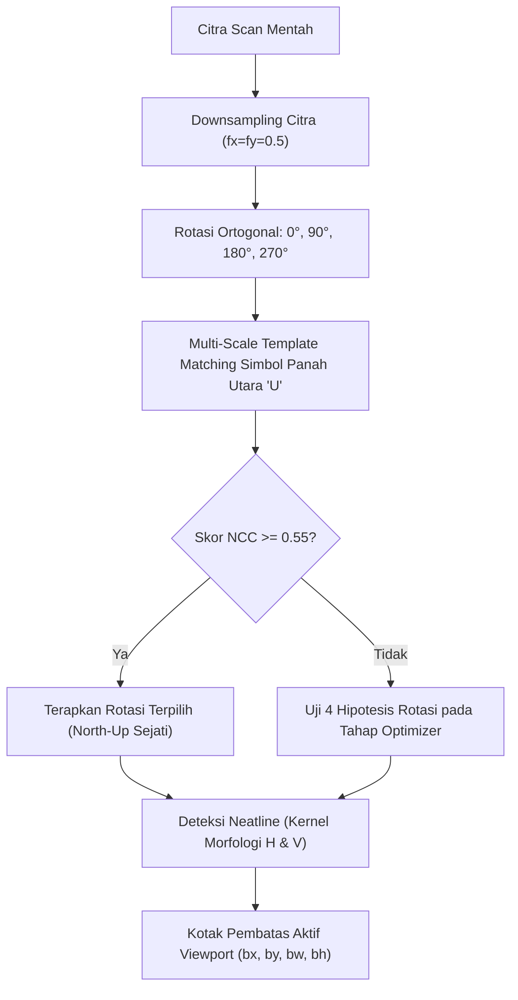
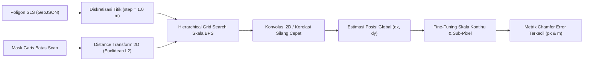
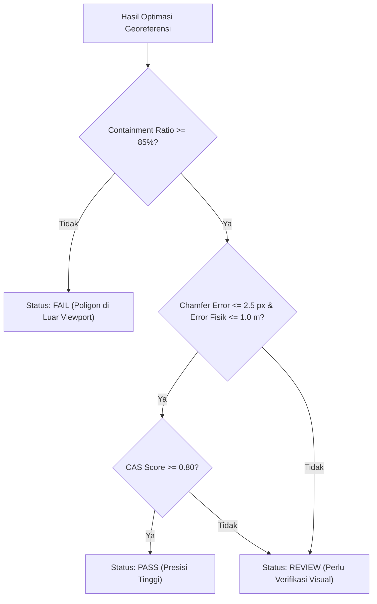

# Landasan Teori & Metodologi Algoritma Auto-Georeferencer

Dokumen ini memaparkan landasan matematika, geodesi, visi komputer (*Computer Vision*), dan metodologi optimasi yang digunakan dalam pipeline **Wilkerstat Autonomous Georeferencing Tool**.

---

## 1. Konsep Dasar & Formulasi Transformasi Spasial

### 1.1 Transformasi Affine 2D
Georeferensi peta scan mengasumsikan hubungan pemetaan affine linier berorde-1 antara koordinat piksel citra $(x, y)$ dan koordinat geodetik bujur/lintang $(\lambda, \varphi)$ dalam datum WGS84 (EPSG:4326):

$$\begin{bmatrix} \lambda \\ \varphi \end{bmatrix} = \begin{bmatrix} A & B \\ D & E \end{bmatrix} \begin{bmatrix} x \\ y \end{bmatrix} + \begin{bmatrix} C \\ F \end{bmatrix}$$

Atau dalam bentuk skalar:
$$\lambda = A \cdot x + B \cdot y + C$$
$$\varphi = D \cdot x + E \cdot y + F$$

Di mana:
- $x, y$: Indeks kolom dan baris piksel pada citra (berawal dari pojok kiri-atas $[0, 0]$).
- $\lambda$: Bujur (*Longitude*) dalam derajat desimal.
- $\varphi$: Lintang (*Latitude*) dalam derajat desimal.
- $A$: Resolusi spasial horizontal (derajat/piksel sepanjang sumbu $X$).
- $E$: Resolusi spasial vertikal (derajat/piksel sepanjang sumbu $Y$, bernilai negatif karena indeks piksel $y$ bertambah ke arah selatan).
- $B, D$: Parameter rotasi / *shear* (pada peta tegak *North-Up*, $B = 0$ dan $D = 0$).
- $C, F$: Koordinat geografis titik tengah piksel pojok kiri-atas $[0, 0]$.

---

### 1.2 Format ESRI Worldfile 6-Baris (`.jgw` / `.pgw`)
File worldfile ESRI menyimpan 6 koefisien transformasi affine baris-demi-baris:

$$\begin{aligned}
\text{Line 1} &: A \quad (\text{Ukuran piksel arah } X) \\
\text{Line 2} &: D \quad (\text{Rotasi arah } Y) \\
\text{Line 3} &: B \quad (\text{Rotasi arah } X) \\
\text{Line 4} &: E \quad (\text{Ukuran piksel arah } Y, \text{negatif}) \\
\text{Line 5} &: C \quad (\text{Bujur sudut kiri-atas}) \\
\text{Line 6} &: F \quad (\text{Lintang sudut kiri-atas})
\end{aligned}$$

---

### 1.3 Hubungan Skala Kartografis, DPI, dan Resolusi Geodetik
Peta cetak Wilkerstat BPS diproduksi pada resolusi standar pemindaian $300\text{ DPI}$ (*dots per inch*). Satu inci setara dengan $0.0254\text{ meter}$, sehingga ukuran fisik satu piksel di atas kertas adalah:

$$\text{Pitch Piksel} = \frac{0.0254\text{ m}}{300\text{ px}} \approx 8.4667 \times 10^{-5}\text{ m/px}$$

Jika peta memiliki skala representatif $1:S$ (misalnya $1:1000$ atau $1:2500$), maka resolusi di permukaan bumi ($R_m$, meter/piksel) bernilai:

$$R_m = S \cdot \left(\frac{0.0254}{300}\right)$$

Konversi dari resolusi fisik meter ke derajat geodetik WGS84 pada ekuator/wilayah tropis Indonesia:
$$A = \frac{R_m}{\text{M\_PER\_DEG\_LON}} = \frac{R_m}{111\,319.5}$$
$$E = -\frac{R_m}{\text{M\_PER\_DEG\_LAT}} = -\frac{R_m}{110\,574.0}$$

---

## 2. Deteksi Orientasi North-Up & Bingkai Aktif (*Neatline*)

### 2.1 Deteksi Simbol Arah Utara (North Arrow) via NCC
Untuk mendeteksi apakah citra scan tersimpan terbalik atau menyamping, sistem memanfaatkan *Normalized Cross-Correlation* (NCC) multi-skala terhadap templat simbol panah utara $T$:

$$R(x, y) = \frac{\sum_{x', y'} (T'(x', y') \cdot I'(x + x', y + y'))}{\sqrt{\sum_{x', y'} T'(x', y')^2 \cdot \sum_{x', y'} I'(x + x', y + y')^2}}$$

Di mana $T'$ dan $I'$ merupakan intensitas setelah dikurangi nilai rata-ratanya (*zero-mean*). Evaluasi dilakukan pada 4 sudut rotasi ortogonal $\theta \in \{0^\circ, 90^\circ, 180^\circ, 270^\circ\}$ dan rentang skala templat $s \in \{0.85, 1.00, 1.15\}$.

### 2.2 Segmentasi Bingkai Aktif (*Neatline*)
Peta Wilkerstat dibatasi oleh garis kotak tepi hitam tebal (*neatline*). Untuk mengisolasi area peta dari margin informasi administratif (nama SLS, legenda, logo), diaplikasikan operasi morfologi pembukaan (*morphological opening*) dengan kernel linier terarah:

$$K_{\text{horizontal}} = \text{rect}(L_h, 1), \quad L_h = 0.20 \times W$$
$$K_{\text{vertikal}} = \text{rect}(1, L_v), \quad L_v = 0.20 \times H$$

$$\text{Grid} = (I_{\text{bin}} \circ K_{\text{horizontal}}) \cup (I_{\text{bin}} \circ K_{\text{vertikal}})$$

Kontur penutup terluar yang memenuhi kriteria rasio area ($0.35 \le \frac{\text{Area}}{\text{Total Area}} \le 0.90$) dipilih sebagai *Bounding Viewport* $(bx, by, bw, bh)$.

---

## 3. Ekstraksi Garis Batas SLS Multi-Warna

Peta scan Wilkerstat memuat batas SLS yang digambar dalam 3 kategori warna kartografis:
1. **Merah / Magenta**: Batas SLS utama yang sedang dipetakan.
2. **Jingga / Oranye**: Batas turunan / sub-SLS.
3. **Cyan / Biru Muda**: Batas perairan atau batas SLS tetangga.

### 3.1 Segmentasi Warna Diferensial HSV + RGB
Untuk mengatasi degradasi akibat pemindaian (kertas menguning, variasi tinta scan), sistem mengombinasikan ruang warna HSV dan komparasi kanal RGB secara simultan:

$$\begin{aligned}
\text{Mask}_{\text{Merah}} &= \left[(H < 15^\circ \lor H > 160^\circ) \land S > 38 \land V > 45 \land (R - B > 15) \land (R - G > 10)\right] \\
\text{Mask}_{\text{Oranye}} &= \left[15^\circ \le H \le 28^\circ \land S > 45 \land V > 65 \land (R - B > 20) \land (R - G > 6)\right] \\
\text{Mask}_{\text{Cyan}} &= \left[95^\circ \le H \le 125^\circ \land S > 35 \land V > 65 \land (B - R > 15)\right]
\end{aligned}$$

Mask akhir diperoleh dari gabungan ketiganya:
$$\text{Mask}_{\text{Batas}} = \text{Mask}_{\text{Merah}} \cup \text{Mask}_{\text{Oranye}} \cup \text{Mask}_{\text{Cyan}}$$

### 3.2 Penutupan Celah Garis Putus-Putus
Garis batas kartografis sering berupa garis putus-putus (*dashed line*). Celah antar-segmen disambungkan menggunakan operasi penutupan morfologi (*morphological closing*) dengan elemen penstruktur kotak $3 \times 3$:

$$\text{Mask}_{\text{Kontinu}} = (\text{Mask}_{\text{Batas}} \oplus K_{3\times 3}) \ominus K_{3\times 3}$$

---

## 4. Closed-Loop Optimizer & Chamfer Distance Transform

### 4.1 Diskretisasi Poligon Batas SLS
Poligon acuan GeoJSON/GeoPackage diubah menjadi deretan sampel titik berjarak teratur sepanjang keliling poligon ($P = \{p_1, p_2, \dots, p_N\}$) dengan interval jarak fisik $\Delta s = 1.0\text{ meter}$.

### 4.2 Distance Transform 2D
Pada mask biner garis batas hasil scan $B$, dihitung medan jarak Euclidean (*Distance Transform*) $D(x, y)$, di mana setiap nilai piksel menyatakan jarak terdekat ke garis batas scan:

$$D(x, y) = \min_{(x_b, y_b) \in B} \sqrt{(x - x_b)^2 + (y - y_b)^2}$$

Operasi ini dihitung dalam kompleksitas waktu linier $\mathcal{O}(W \times H)$ menggunakan algoritma dekomposisi parabola Felzenszwalb-Huttenlocher.

### 4.3 Formulasi Chamfer Alignment Error
Untuk sembarang parameter transformasi affine $T = (A, E, C, F)$, titik poligon $p_i = (\lambda_i, \varphi_i)$ diproyeksikan ke ruang piksel citra:

$$x_i = \frac{\lambda_i - C}{A}, \quad y_i = \frac{\varphi_i - F}{E}$$

*Chamfer Alignment Error* $\mathcal{E}_{\text{chamfer}}$ didefinisikan sebagai rata-rata jarak piksel dari seluruh titik sampel terhadap garis batas peta terdekat:

$$\mathcal{E}_{\text{chamfer}}(T) = \frac{1}{N} \sum_{i=1}^{N} D(x_i, y_i)$$

Dan estimasi deviasi fisik dalam satuan meter di permukaan bumi:
$$\mathcal{E}_{\text{fisik}} = \mathcal{E}_{\text{chamfer}} \times R_m = \mathcal{E}_{\text{chamfer}} \times \left(S \cdot \frac{0.0254}{300}\right)$$

### 4.4 Konvolusi 2D untuk Translasi Global Cepat
Untuk menghindari pencarian translasi yang lambat melalui *brute-force*, sistem mengonversi sampel titik poligon pada skala kandidat $S$ menjadi citra biner template $T_S$, kemudian menghitung korelasi silang 2D ternormalisasi (*Fast Fourier Transform Convolution*) terhadap medan jarak:

$$(x^*, y^*) = \arg\min_{(x, y)} (D * T_S)(x, y)$$

Hal ini menjamin pencarian translasi spasial optimal global dapat ditemukan dalam hitungan milidetik tanpa risiko terjebak pada *local minima*.

---

## 5. Integrasi Citra Satelit Google Hybrid & Slippy Map

Untuk memverifikasi keselarasan dunia nyata dan mengoreksi pergeseran jalan/bangunan, sistem mengintegrasikan citra satelit Google Hybrid (`lyrs=y`).

### 5.1 Transformasi Slippy Map Web Mercator (EPSG:3857)
Koordinat geodetik titik pojok batas SLS $(\varphi, \lambda)$ dikonversi ke indeks tile Slippy Map $(x_{\text{tile}}, y_{\text{tile}})$ pada tingkat pembesaran $z = 18$:

$$\begin{aligned}
n &= 2^z \\
x_{\text{tile}} &= \left\lfloor \frac{\lambda + 180^\circ}{360^\circ} \times n \right\rfloor \\
y_{\text{tile}} &= \left\lfloor \left( 1 - \frac{\ln(\tan \varphi + \sec \varphi)}{\pi} \right) \times \frac{n}{2} \right\rfloor = \left\lfloor \left( 1 - \frac{\text{asinh}(\tan \varphi)}{\pi} \right) \times \frac{n}{2} \right\rfloor
\end{aligned}$$

Sebaliknya, koordinat sudut barat-laut (*North-West*) dari tile $(x_{\text{tile}}, y_{\text{tile}})$ dihitung kembali dengan:
$$\begin{aligned}
\lambda_{\text{NW}} &= \frac{x_{\text{tile}}}{n} \times 360^\circ - 180^\circ \\
\varphi_{\text{NW}} &= \arctan\left( \sinh\left( \pi \left(1 - \frac{2 \cdot y_{\text{tile}}}{n}\right) \right) \right) \times \frac{180^\circ}{\pi}
\end{aligned}$$

### 5.2 Ekstraksi Tepi Struktural & Korelasi Multimodal
1. **Bilateral Filtering**: Mereduksi derau tekstur tanah pada citra satelit tanpa mengaburkan tepi batas fisik jalan/bangunan:
   $$I_{\text{filtered}}(p) = \frac{1}{W_p} \sum_{q \in \Omega} I(q) \, G_{\sigma_s}(\|p - q\|) \, G_{\sigma_r}(|I(p) - I(q)|)$$
2. **Homografi Perspektif**: Empat sudut *viewport* peta scan ditransformasikan ke bidang koordinat piksel mozaik satelit:
   $$\mathbf{x}_{\text{mosaic}} \sim H \, \mathbf{x}_{\text{scan}}$$
3. **Korelasi Tepi Berimpit**: Mengukur proporsi tumpang-tindih piksel tepi jalan antara peta dan citra satelit setelah pelebaran (*dilation*) $3 \times 3$:
   $$\text{Score}_{\text{structural}} = \min\left(1.0, \frac{\sum (E_{\text{scan}} \land E_{\text{satelit\_dilated}})}{\max(100, 0.35 \times \sum E_{\text{scan}})}\right)$$

---

## 6. Kriteria Quality Gate & Composite Alignment Score (CAS)

Setiap hasil georeferensi dievaluasi secara otonom melalui sistem *Quality Gate* berlapis:

### 6.1 Rasio Pengurungan (*Containment Ratio*)
Menjamin seluruh poligon batas SLS berada di dalam area aktif peta scan (*neatline*), bukan jatuh di margin teks atau luar kertas:

$$\text{Ratio}_{\text{containment}} = \frac{1}{N} \sum_{i=1}^N \mathbf{1}_{\left(x_i \in [bx, bx+bw] \land y_i \in [by, by+bh]\right)} \ge 0.85$$

### 6.2 Composite Alignment Score (CAS)
Menggabungkan konsistensi bentuk batas poligon dan korelasi citra satelit menjadi satu metrik komposit terpadu $[0.0, 1.0]$:

$$\text{CAS} = w_1 \cdot \text{Ratio}_{\text{containment}} + w_2 \cdot \max\left(0, 1 - \frac{\mathcal{E}_{\text{chamfer}}}{\mathcal{E}_{\text{max}}}\right) + w_3 \cdot \text{Score}_{\text{structural}}$$

Dengan bobot default: $w_1 = 0.40$, $w_2 = 0.40$, $w_3 = 0.20$, serta $\mathcal{E}_{\text{max}} = 2.5\text{ px}$.

- **PASS**: $\text{CAS} \ge 0.80$, $\mathcal{E}_{\text{chamfer}} \le 2.5\text{ px}$, dan $\text{Ratio}_{\text{containment}} \ge 0.85$.
- **REVIEW**: Hasil berada di sekitar batas toleransi yang memerlukan pengecekan mata (*visual check* pada `preview_*.png`).
- **FAIL**: Poligon terpotong keluar dari bingkai neatline atau deviasi melebihi batas fisik kartografis BPS.
